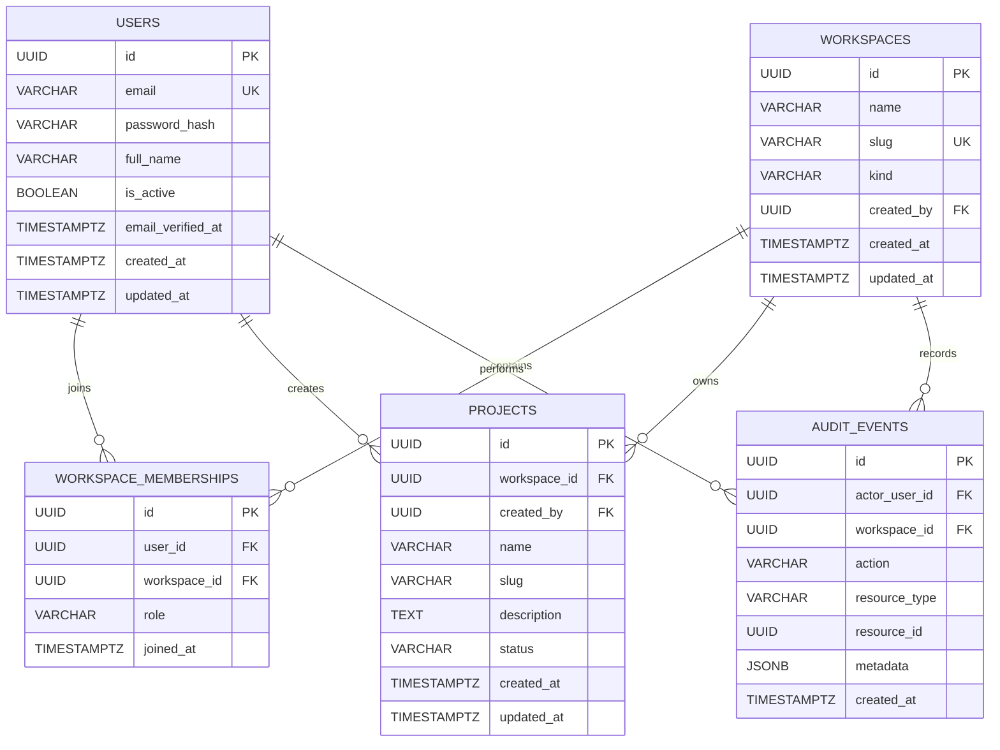

# CloudForge — Database Schema & Architecture

**Document Type:** Technical Architecture Documentation
**Project:** CloudForge
**Database:** PostgreSQL (Neon)
**ORM:** SQLAlchemy
**Migration Tool:** Flask-Migrate / Alembic
**Schema Status:** Approved Design — Implementation Pending

---

## 1. Overview

CloudForge uses a relational database architecture built around user identity, workspace ownership, project management and audit logging.

The initial database schema consists of five core entities:

1. `users`
2. `workspaces`
3. `workspace_memberships`
4. `projects`
5. `audit_events`

The database is designed to support multi-user collaboration, workspace-level authorization, project isolation and auditable operations.

### Technology Stack

| Component | Technology |
|---|---|
| Database | PostgreSQL |
| Hosting | Neon |
| ORM | SQLAlchemy |
| Migration management | Flask-Migrate |
| Migration engine | Alembic |
| Primary keys | UUID |
| Structured metadata | PostgreSQL JSONB |
| Backend | Python / Flask |

---

## 2. Entity Relationship Diagram (ERD)

The following diagram represents the approved initial database design.

### Relationship Explanation

| Relationship | Cardinality | Description |
|---|---|---|
| Users → Workspace Memberships | One-to-Many | A user can join multiple workspaces. |
| Workspaces → Workspace Memberships | One-to-Many | A workspace can contain multiple users. |
| Workspaces → Projects | One-to-Many | A workspace can own multiple projects. |
| Users → Projects | One-to-Many | A user can create multiple projects. |
| Users → Audit Events | One-to-Many | A user can perform multiple recorded actions. |
| Workspaces → Audit Events | One-to-Many | A workspace can contain multiple audit records. |

The `workspace_memberships` table establishes a many-to-many relationship between users and workspaces.

---

## 3. Table Specifications

### 3.1 Users

**Table:** `users`

Stores registered CloudForge accounts and authentication information.

| Column | PostgreSQL Type | Constraints |
|---|---|---|
| id | UUID | Primary Key |
| email | VARCHAR(255) | Unique, Not Null |
| password_hash | VARCHAR(255) | Not Null |
| full_name | VARCHAR(120) | Not Null |
| is_active | BOOLEAN | Not Null, Default TRUE |
| email_verified_at | TIMESTAMPTZ | Nullable |
| created_at | TIMESTAMPTZ | Not Null |
| updated_at | TIMESTAMPTZ | Not Null |

**Design decisions:**
- Normalize email addresses before storage.
- Enforce case-insensitive email uniqueness.
- Store Argon2 password hashes, never plaintext passwords.
- Use UUID identifiers.
- Preserve historical audit information when accounts are deactivated.

### 3.2 Workspaces

**Table:** `workspaces`

Represents an organizational boundary for projects and resources.

| Column | PostgreSQL Type | Constraints |
|---|---|---|
| id | UUID | Primary Key |
| name | VARCHAR(120) | Not Null |
| slug | VARCHAR(120) | Unique, Not Null |
| kind | VARCHAR(20) | Not Null |
| created_by | UUID | Foreign Key → users.id |
| created_at | TIMESTAMPTZ | Not Null |
| updated_at | TIMESTAMPTZ | Not Null |

**Workspace kinds:**
- `personal`
- `team`

**Design decisions:**
- Automatically create a personal workspace during user registration.
- Assign its creator the `owner` role.
- A user can have only one personal workspace.
- Support multiple team workspaces.
- Workspace slugs must be globally unique.

### 3.3 Workspace Memberships

**Table:** `workspace_memberships`

Connects users to workspaces and defines their access roles.

| Column | PostgreSQL Type | Constraints |
|---|---|---|
| id | UUID | Primary Key |
| user_id | UUID | Foreign Key → users.id |
| workspace_id | UUID | Foreign Key → workspaces.id |
| role | VARCHAR(20) | Not Null |
| joined_at | TIMESTAMPTZ | Not Null |

**Approved roles:**

| Role | Responsibility |
|---|---|
| owner | Full workspace control |
| admin | Manage members and projects |
| developer | Create and manage projects and deployments |
| viewer | Read-only access |

**Constraints:**

- Unique `(user_id, workspace_id)`.
- Role must belong to the approved role set.
- Index `user_id`.
- Index `workspace_id`.

### 3.4 Projects

**Table:** `projects`

Stores projects managed inside CloudForge workspaces.

| Column | PostgreSQL Type | Constraints |
|---|---|---|
| id | UUID | Primary Key |
| workspace_id | UUID | Foreign Key → workspaces.id |
| created_by | UUID | Foreign Key → users.id |
| name | VARCHAR(120) | Not Null |
| slug | VARCHAR(120) | Not Null |
| description | TEXT | Nullable |
| status | VARCHAR(20) | Not Null, Default active |
| created_at | TIMESTAMPTZ | Not Null |
| updated_at | TIMESTAMPTZ | Not Null |

**Project statuses:**
- `active`
- `archived`

**Constraints:**

- Unique `(workspace_id, slug)`.
- Index `workspace_id`.
- Index `created_by`.

**Archival strategy:**

Projects will be archived rather than permanently deleted in the initial implementation.

This preserves project identity and provides a foundation for retaining future deployment history.

### 3.5 Audit Events

**Table:** `audit_events`

Stores important actions performed by users or the CloudForge system.

| Column | PostgreSQL Type | Constraints |
|---|---|---|
| id | UUID | Primary Key |
| actor_user_id | UUID | Nullable Foreign Key → users.id |
| workspace_id | UUID | Nullable Foreign Key → workspaces.id |
| action | VARCHAR(100) | Not Null |
| resource_type | VARCHAR(50) | Not Null |
| resource_id | UUID | Nullable |
| metadata | JSONB | Not Null, Default empty object |
| created_at | TIMESTAMPTZ | Not Null |

**Example actions:**

| Action | Resource |
|---|---|
| user.registered | User |
| workspace.created | Workspace |
| member.invited | Workspace |
| project.created | Project |
| project.archived | Project |
| deployment.started | Deployment |
| infrastructure.destroyed | Infrastructure |

The last two examples anticipate future CloudForge functionality.

**Design decisions:**
- Use JSONB for flexible event metadata.
- Preserve historical audit records.
- Treat audit events as append-only through normal application operations.
- Never store passwords, session tokens or cloud credentials in audit metadata.

---

## 4. Database Constraints and Indexes

| Table | Constraint / Index | Purpose |
|---|---|---|
| users | Unique normalized email | Prevent duplicate accounts |
| workspaces | Unique slug | Prevent duplicate workspace identifiers |
| workspaces | Partial unique index on personal workspace creator | One personal workspace per user |
| workspace_memberships | Unique user_id + workspace_id | Prevent duplicate memberships |
| workspace_memberships | Index user_id | Retrieve user workspaces |
| workspace_memberships | Index workspace_id | Retrieve workspace members |
| projects | Unique workspace_id + slug | Prevent duplicate project slugs within a workspace |
| projects | Index workspace_id | Retrieve workspace projects |
| projects | Index created_by | Retrieve projects by creator |
| audit_events | Composite index workspace_id + created_at | Retrieve workspace activity |
| audit_events | Composite index actor_user_id + created_at | Retrieve user activity |

Primary keys and unique constraints already create their own indexes in PostgreSQL. Avoid adding redundant indexes.

---

## 5. Referential Integrity and Deletion Policies

CloudForge will avoid uncontrolled cascading deletion.

| Relationship | Policy |
|---|---|
| User → Workspace creator | Restrict deletion or require ownership reassignment |
| User → Membership | Handle eligible memberships explicitly |
| Workspace → Membership | Restrict deletion until memberships are handled |
| Workspace → Projects | Restrict deletion while projects exist |
| User → Project creator | Preserve creator attribution |
| User → Audit event actor | Set NULL to preserve history |
| Workspace → Audit event | Set NULL if workspace is eventually removed |

**Additional integrity rules:**

1. Every workspace must have at least one owner.
2. The last workspace owner cannot remove their own ownership.
3. Registration must create the user, personal workspace and owner membership atomically.
4. Project archival must preserve the existing project record.
5. Audit history must remain available after account deactivation.

The last-owner rule requires transactional application logic or a database-level mechanism.

---

## 6. Authorization Architecture

CloudForge uses workspace membership as the basis of project authorization.

A project ID alone must never grant access.

Before performing a project operation, the backend must verify:

1. The user is authenticated.
2. The requested project exists.
3. The project belongs to a particular workspace.
4. The user has a membership in that workspace.
5. The user's role permits the requested action.

This protects against insecure direct object reference attacks, including users attempting to access other users' projects by changing API identifiers.

---

## 7. Future Schema Extensions

The following entities are intentionally deferred until their respective features are implemented.

| Future Entity | Responsibility |
|---|---|
| deployments | Deployment history and orchestration |
| repositories | GitHub repository connections |
| environments | Development, staging and production |
| runner_jobs | Cloud Runner execution jobs |
| cloud_credentials | Cloud provider credential references |
| infrastructure_resources | Terraform resource tracking |
| refresh_tokens | Only if required by the authentication strategy |

---

## 8. Approved Architecture Decisions

| Decision | Approved Design |
|---|---|
| Database | Neon PostgreSQL |
| Primary keys | UUID |
| Workspace creation | Automatic personal workspace during registration |
| Workspace roles | Owner, Admin, Developer, Viewer |
| Project deletion | Archive instead of permanent deletion |
| Project ownership | Workspace-based |
| Membership model | Many-to-many |
| Password storage | Argon2 hashes |
| Audit metadata | PostgreSQL JSONB |
| Schema migrations | Flask-Migrate / Alembic |

---

## 9. Implementation Status

**Current status:** Approved design, implementation pending.

| Implementation Task | Status |
|---|---|
| Schema architecture | Approved |
| SQLAlchemy models | Pending |
| Database constraints | Pending |
| Database indexes | Pending |
| Initial migration | Pending |
| Neon migration execution | Pending |
| Seed/demo data | Pending |
| Database integration tests | Pending |

---

## 10. Future Interview Discussion Points

This architecture provides several useful topics for technical interviews:

1. Why PostgreSQL instead of a document database?
2. Why use UUID primary keys?
3. Why use a separate membership table?
4. How does workspace-level multi-user authorization work?
5. Why enforce constraints in both the application and database?
6. Why use JSONB for audit metadata?
7. How do transactions protect user registration?
8. How does CloudForge preserve project and audit history?
9. How would the database evolve to support deployment history and Runner jobs?

**Important:** This document describes the approved architecture. Implementation details and actual database behavior should be updated after migrations and tests are completed.