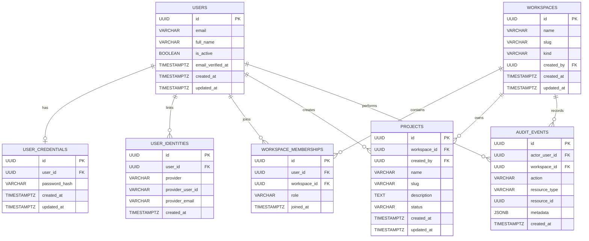

CloudForge — Database Schema & Architecture
Document type: Technical architecture and implementation reference
Project: CloudForge
Database: PostgreSQL (Neon)
Backend: Python / Flask
ORM: SQLAlchemy
Migrations: Flask-Migrate / Alembic
Schema status: Initial schema implemented; migration applied and verified

1. Purpose and Scope
CloudForge uses a relational data model to manage user identity, workspace ownership, membership-based authorization, projects, and audit history.

The database is designed around a clear separation of concerns:
- Identity: a CloudForge user is independent of the method used to authenticate.
- Credentials: password hashes and external provider identities are stored separately from the user profile.
- Collaboration: users join workspaces through an explicit membership entity.
- Project isolation: every project belongs to a workspace.
- Authorization: access is determined by authenticated identity, workspace membership, and role.
- Auditability: important actions are recorded without placing credentials or secrets in event metadata.
The initial schema contains seven tables:
Table	Responsibility
users	Canonical CloudForge user profile
user_credentials	Optional CloudForge password credential
user_identities	External identity-provider accounts linked to a user
workspaces	Personal and team ownership boundary
workspace_memberships	User-to-workspace membership and role
projects	Projects owned by a workspace
audit_events	Append-oriented record of important actions

This document describes the implemented initial data model. Feature-specific entities such as deployments, repositories, and Runner jobs are intentionally deferred until those features are introduced.
2. Authentication and Identity Model
CloudForge supports a hybrid identity model:
- Email/password: the Flask backend verifies a CloudForge password credential. Passwords are stored only as Argon2id hashes.
- Google sign-in: Google OpenID Connect establishes the external identity. The backend validates the identity response and resolves it to a CloudForge user.
- One application identity: both sign-in methods resolve to the same users record.
- CloudForge-owned authorization: an external identity provider does not grant workspace or project permissions. CloudForge applies its own membership and role checks.
A user can have a user_credentials row, one or more user_identities rows, or both. A Google-only account does not require a password credential.

The external provider's stable subject identifier (sub for OpenID Connect) is used as the identity key. Provider email is retained as informational data; it is not a stable provider identifier and must not be used for silent account linking.

Firebase Authentication is not part of the approved initial architecture.
3. Technology and Data Conventions
Area	Implementation
Relational database	PostgreSQL
Development database hosting	Neon
Database access	SQLAlchemy ORM
Schema migration interface	Flask-Migrate
Migration engine	Alembic
Primary keys	UUID
Timestamps	Time-zone-aware PostgreSQL timestamps (TIMESTAMPTZ)
Flexible event attributes	PostgreSQL JSONB
Password hashing	Argon2id
External identity protocol	Google OAuth 2.0 / OpenID Connect
Browser authentication	CloudForge-managed secure session
CLI authentication	Separate short-lived token/device authorization flow

3.1 Data conventions
- UUID primary keys provide stable identifiers that do not expose sequential record counts.
- Email addresses are normalized before persistence and protected by a case-insensitive unique index.
- Timestamps are stored with time-zone information.
- Foreign keys express ownership and relationship integrity in the database, not only in application code.
- Enumerated business values such as workspace kind, membership role, and project status are constrained to approved values.
- Sensitive authentication material is excluded from audit metadata.
4. Entity Relationship Diagram
The following Mermaid ER diagram uses GitHub-compatible attribute declarations. Uniqueness that is enforced by a separate constraint or index is described in the table specifications and constraint inventory rather than combining multiple key annotations on one Mermaid attribute.

4.1 Relationship summary
Relationship	Cardinality	Meaning
User → User credential	One-to-zero-or-one	A user may have at most one password credential
User → User identities	One-to-many	A user may link multiple external provider identities
User → Workspace memberships	One-to-many	A user may join multiple workspaces
Workspace → Workspace memberships	One-to-many	A workspace may contain multiple members
Workspace → Projects	One-to-many	A workspace owns its projects
User → Projects	One-to-many	A user is recorded as the creator of projects
User → Audit events	One-to-many	An event may identify the user who performed it
Workspace → Audit events	One-to-many	An event may be associated with a workspace

workspace_memberships is the associative entity that implements the many-to-many relationship between users and workspaces. It also stores relationship-specific data—the member's role and join timestamp—which is why a direct many-to-many mapping alone would not be sufficient.
5. Table Specifications
5.1 users
Purpose: Stores the canonical CloudForge account profile. Authentication-specific data is kept in separate tables so a user remains independent of the sign-in method.
Column	PostgreSQL type	Rules
id	UUID	Primary key
email	VARCHAR(320)	Not null; case-insensitive unique
full_name	VARCHAR(120)	Not null
is_active	BOOLEAN	Not null; default TRUE
email_verified_at	TIMESTAMPTZ	Nullable
created_at	TIMESTAMPTZ	Not null
updated_at	TIMESTAMPTZ	Not null

Design and integrity notes
- The application trims and lowercases email addresses before storing them.
- A unique functional index on lower(email) prevents case-only duplicates at the database boundary.
- Password hashes and provider-specific tokens do not belong in this table.
- Deactivation is preferred to casually deleting an account when historical attribution must be retained.
- External email claims must be verified before they are used for account discovery or linking.
5.2 user_credentials
Purpose: Stores the optional CloudForge-managed password credential.
Column	PostgreSQL type	Rules
id	UUID	Primary key
user_id	UUID	Not null; foreign key to users.id; unique
password_hash	VARCHAR(255)	Not null
created_at	TIMESTAMPTZ	Not null
updated_at	TIMESTAMPTZ	Not null

Design and integrity notes
- Only an Argon2id password hash is stored; plaintext passwords are never persisted.
- A unique constraint on user_id enforces at most one credential row per user.
- The relationship is optional from the user's perspective, allowing Google-only accounts.
- Password changes replace the hash and update the timestamp without changing the user's identity.
- Password-reset tokens are outside the initial schema. If introduced, they should be stored separately as securely hashed, expiring values.
5.3 user_identities
Purpose: Links a CloudForge user to an external identity-provider account. Google is the initial provider; the table can accommodate additional providers later.
Column	PostgreSQL type	Rules
id	UUID	Primary key
user_id	UUID	Not null; foreign key to users.id
provider	VARCHAR(30)	Not null
provider_user_id	VARCHAR(255)	Not null
provider_email	VARCHAR(320)	Nullable
created_at	TIMESTAMPTZ	Not null

Constraints and indexes
- Unique (provider, provider_user_id) prevents the same external identity from being attached to multiple CloudForge users.
- An index on user_id supports retrieval of identities linked to a user.
- Provider identifiers are normalized lowercase values, initially google.
- For Google OpenID Connect, provider_user_id stores the stable sub claim.
- provider_email is informational and is not the identity key.
Security notes
- The backend validates the identity token's signature, issuer, audience, and expiry, and validates the OAuth flow's state and nonce protections.
- Account linking must not occur merely because two email strings match. Linking requires an authenticated and verified flow.
- Access tokens, refresh tokens, ID tokens, OAuth client secrets, and other provider secrets are not stored in this table.
- If future provider API access requires token retention, it needs a dedicated encrypted credential design.
5.4 workspaces
Purpose: Defines the organizational boundary under which projects and related resources are managed.
Column	PostgreSQL type	Rules
id	UUID	Primary key
name	VARCHAR(120)	Not null
slug	VARCHAR(120)	Not null; globally unique
kind	VARCHAR(20)	Not null; personal or team
created_by	UUID	Foreign key to users.id
created_at	TIMESTAMPTZ	Not null
updated_at	TIMESTAMPTZ	Not null

Design and integrity notes
- Registration creates a personal workspace and an owner membership in the same transaction as the user account.
- A partial unique index on created_by for rows where kind = 'personal' enforces at most one personal workspace per creator.
- A check constraint limits kind to personal or team.
- Workspace slugs are globally unique in the initial design.
- Team workspaces support collaboration through workspace_memberships.
5.5 workspace_memberships
Purpose: Connects users to workspaces and stores the role granted within each workspace.
Column	PostgreSQL type	Rules
id	UUID	Primary key
user_id	UUID	Not null; foreign key to users.id
workspace_id	UUID	Not null; foreign key to workspaces.id
role	VARCHAR(20)	Not null; constrained to approved roles
joined_at	TIMESTAMPTZ	Not null

Approved roles
Role	Responsibility
owner	Full workspace control
admin	Manage members and projects
developer	Create and manage projects and deployments
viewer	Read-only access

Constraints and indexes
- Unique (user_id, workspace_id) prevents duplicate memberships.
- A check constraint restricts role to owner, admin, developer, or viewer.
- Separate indexes on user_id and workspace_id support user-workspace and workspace-member lookups.
The membership row is not merely a join record: it is the source of workspace-scoped role information used by authorization logic.
5.6 projects
Purpose: Stores projects managed by CloudForge within a workspace.
Column	PostgreSQL type	Rules
id	UUID	Primary key
workspace_id	UUID	Not null; foreign key to workspaces.id
created_by	UUID	Not null; foreign key to users.id
name	VARCHAR(120)	Not null
slug	VARCHAR(120)	Not null
description	TEXT	Nullable
status	VARCHAR(20)	Not null; default active
created_at	TIMESTAMPTZ	Not null
updated_at	TIMESTAMPTZ	Not null

Project statuses: active, archived.

Constraints and indexes
- Unique (workspace_id, slug) allows the same slug in different workspaces but prevents duplicates within one workspace.
- A check constraint restricts project status to the approved values.
- Indexes on workspace_id and created_by support workspace listing and creator-based queries.
Lifecycle policy

Projects are archived rather than permanently deleted in the initial implementation. Archival preserves the project record and provides a stable reference for future deployment history and audit records.
5.7 audit_events
Purpose: Records important actions performed by a user or by the CloudForge system.
Column	PostgreSQL type	Rules
id	UUID	Primary key
actor_user_id	UUID	Nullable; foreign key to users.id
workspace_id	UUID	Nullable; foreign key to workspaces.id
action	VARCHAR(100)	Not null
resource_type	VARCHAR(50)	Not null
resource_id	UUID	Nullable
metadata	JSONB	Not null; default empty object
created_at	TIMESTAMPTZ	Not null

Example event names
Action	Resource
user.registered	User
user.login_succeeded	User
user.login_failed	User
user.identity_linked	User
workspace.created	Workspace
member.invited	Workspace
project.created	Project
project.archived	Project
deployment.started	Deployment (future feature)
infrastructure.destroyed	Infrastructure (future feature)

Design and security notes
- JSONB supports structured event attributes without requiring a new relational column for every event-specific detail.
- The application treats audit records as append-only during normal operations.
- Foreign keys to the actor and workspace use ON DELETE SET NULL, preserving the event if the referenced account or workspace is eventually removed.
- Never place passwords, session identifiers, access tokens, refresh tokens, OAuth secrets, or cloud credentials in event metadata.
- Avoid logging raw authentication tokens or sensitive provider responses.
6. Constraints, Indexes, and Referential Integrity
6.1 Constraint and index inventory
Table	Constraint / index	Purpose
users	Unique index on lower(email)	Case-insensitive account uniqueness
user_credentials	Unique user_id	At most one password credential per user
user_identities	Unique (provider, provider_user_id)	External identity uniqueness
user_identities	Index user_id	Find identities for a user
workspaces	Unique slug	Globally unique workspace identifier
workspaces	Partial unique index on personal workspace creator	At most one personal workspace per creator
workspace_memberships	Unique (user_id, workspace_id)	Prevent duplicate memberships
workspace_memberships	Index user_id	Find workspaces for a user
workspace_memberships	Index workspace_id	Find members of a workspace
projects	Unique (workspace_id, slug)	Unique project slug within a workspace
projects	Index workspace_id	List projects in a workspace
projects	Index created_by	Find projects by creator
audit_events	Composite index (workspace_id, created_at)	Retrieve workspace activity chronologically
audit_events	Composite index (actor_user_id, created_at)	Retrieve user activity chronologically

PostgreSQL automatically creates indexes to support primary-key and unique constraints. Additional indexes should be introduced only when they support a real query pattern; redundant indexes increase write and storage costs.
6.2 Why constraints exist at the database layer
Application validation improves error messages and rejects invalid requests early. It is not sufficient as the only integrity boundary: concurrent requests, scripts, background jobs, and future services may bypass a particular validation path.

Database constraints provide a final guarantee for invariants such as unique email addresses, valid roles, and valid foreign-key references. The application should still validate inputs and translate integrity failures into appropriate API responses.
6.3 Referential integrity and deletion policy
CloudForge avoids uncontrolled cascading deletion.
Relationship	Policy
User → Password credential	Handle through explicit account lifecycle operations
User → External identity	Handle through explicit account lifecycle operations
User → Workspace creator	Restrict deletion or reassign ownership first
User → Membership	Handle eligible memberships explicitly
Workspace → Membership	Handle memberships before workspace removal
Workspace → Projects	Restrict removal while projects remain
User → Project creator	Preserve creator attribution
User → Audit event actor	Set reference to NULL to preserve history
Workspace → Audit event	Set reference to NULL if workspace is removed

Additional application invariants:
1. Every active workspace must have at least one owner.
2. The last owner cannot remove their own ownership or leave the workspace ownerless.
3. Registration creates the user, authentication record, personal workspace, owner membership, and registration audit event atomically.
4. Project archival preserves the project record.
5. Audit history remains available after account deactivation.
6. One external provider identity can belong to only one CloudForge user.
7. A Google-only user is valid without a user_credentials row.
8. Account linking must not rely on an unverified email match.
The last-owner rule is a cross-row business invariant. A normal row-level CHECK constraint cannot enforce it by itself; it must be protected by carefully transactional application logic or an appropriate database-level mechanism.
7. SQLAlchemy ORM Mapping
The backend maps the seven tables to SQLAlchemy model classes:
Database table	ORM model
users	User
user_credentials	UserCredential
user_identities	UserIdentity
workspaces	Workspace
workspace_memberships	WorkspaceMembership
projects	Project
audit_events	AuditEvent

7.1 Mapping concepts used
- Declarative model: each Python model class maps to a database table through SQLAlchemy's declarative mapping.
- Mapped and mapped_column: typed ORM attributes and column definitions describe the mapped schema.
- relationship: describes object-level navigation between related models; it complements, but does not replace, database foreign keys.
- back_populates: connects the two sides of a bidirectional ORM relationship so changes can be navigated consistently.
- ForeignKey: declares the relational reference between tables.
- UniqueConstraint, CheckConstraint, and Index: express database-level invariants and query-supporting indexes.
- server_default: asks the database to supply a default when an insert omits the column.
- onupdate: configures SQLAlchemy-side update behavior for a mapped column; it is not equivalent to a database trigger.
7.2 PostgreSQL JSONB and SQLite test compatibility
audit_events.metadata uses PostgreSQL JSONB in production. The SQLAlchemy type mapping uses a generic JSON type with a PostgreSQL-specific JSONB variant so the same model can also create tables in the SQLite in-memory test database.

This is a test portability measure. The production database remains PostgreSQL, and the initial production migration creates the JSONB column.
7.3 ORM relationships
The model relationships support navigation such as:
- user.credential and user.identities
- user.workspace_memberships
- workspace.memberships and workspace.projects
- project.workspace and project.creator
- audit_event.actor and audit_event.workspace
ORM relationships describe how application objects are connected. Database foreign keys and constraints remain the authoritative integrity rules.
8. Migrations and Schema Lifecycle
CloudForge uses Flask-Migrate as the Flask integration for Alembic.
- Alembic manages versioned database schema changes.
- Flask-Migrate exposes migration commands through the Flask application.
- A migration revision records the operations needed to move the database from one schema version to another.
- The alembic_version table records the revision currently applied to a database.
8.1 Initial migration
Property	Value
Revision	fcb2ced77c36
Description	Create identity and workspace data models
Parent revision	None (initial migration)
Database	Neon PostgreSQL
Status	Applied and verified

The initial migration creates all seven tables, their foreign keys, unique/check constraints, and indexes.
8.2 Common migration workflow
Run commands from the backend directory with the project virtual environment active:
# Inspect whether model changes require a migration
flask --app run.py db check

# Generate a migration after reviewing model changes
flask --app run.py db migrate -m "describe schema change"

# Apply pending migrations
flask --app run.py db upgrade

# Inspect the current database revision
flask --app run.py db current

# Review migration history
flask --app run.py db history
Autogenerated migrations must be reviewed before they are applied. Alembic compares model metadata with the database schema, but it cannot reliably infer every intended data migration or semantic change.

Do not edit an already-applied migration to represent a new schema change. Create a new revision instead. For production changes, review locking, backfill, compatibility, rollback, and deployment ordering before applying the migration.
9. Transaction Boundaries and Data Workflows
A transaction groups related database operations into one unit of work. If an operation fails before commit, the application should roll back the transaction so partial state is not persisted.
9.1 Registration transaction
Email/password registration must create the following records atomically:
1. users
2. user_credentials
3. workspaces (personal workspace)
4. workspace_memberships (owner membership)
5. audit_events (user.registered)
Google-based first-time registration follows the same account/workspace creation pattern, substituting a user_identities row for the password credential.

The session is established only after the database transaction succeeds and the applicable verification policy is satisfied.
9.2 Project creation
Project creation should:
1. Authenticate the request.
2. Resolve the target workspace.
3. verify that the user is a member with a role permitted to create projects.
4. Validate the project name and workspace-scoped slug.
5. Insert the project and corresponding audit event in a transaction.
6. Return the created project only after commit.
The unique (workspace_id, slug) constraint remains necessary even if the application checks for an existing slug first, because two concurrent requests can pass an application-level pre-check.
9.3 Archival
Archiving updates a project's status to archived and records an audit event. It does not physically delete the project row. Access rules should distinguish active projects from archived projects where the operation requires it.
10. Authentication and Authorization Boundaries
10.1 Email/password registration and sign-in
Registration validates and normalizes the email, applies the password policy, hashes the password using Argon2id, and creates the account records in a transaction.

Sign-in normalizes the submitted email, finds the account, rejects inactive users, verifies the password hash, and establishes a CloudForge-managed session. Session identifiers must be rotated after authentication. Authentication events must never contain the submitted password or session token.
10.2 Google sign-in
The Google OpenID Connect flow must validate OAuth state and nonce and verify the returned identity token, including signature, issuer, audience, and expiry. The verified (provider, sub) pair resolves the external identity.

A Google ID token proves an external identity; it is not a CloudForge application session. After resolving the CloudForge user, the backend establishes its own session and applies CloudForge authorization normally.
10.3 Browser session security
- Use Secure, HttpOnly, and an appropriate SameSite cookie policy in production.
- Protect state-changing cookie-authenticated requests against CSRF.
- Rotate session identifiers after authentication and privilege changes.
- Enforce session expiration and logout/revocation behavior.
- Allow credentialed CORS requests only from explicitly trusted frontend origins; do not combine wildcard origins with credentials.
- Keep OAuth client secrets and session/signing secrets server-side.
- Use HTTPS for production authentication callbacks and authenticated API traffic.
10.4 CLI authentication
The CLI must not depend on a browser session cookie. It will use a separate short-lived token/device authorization strategy. Tokens must be scoped, revocable, securely stored by the CLI, and excluded from logs. Dedicated session or refresh-token tables will be introduced only when the CLI authentication flow requires them.
10.5 Authorization model
Authentication answers who is making the request. Authorization answers what that identity is allowed to do.

A project ID alone must never grant access. Before a project operation, the backend must verify:
1. The requester is authenticated.
2. The requested project exists.
3. The project belongs to a workspace.
4. The requester has a membership in that workspace.
5. The membership role permits the requested action.
This prevents insecure direct object reference (IDOR) vulnerabilities in which a user changes an object identifier to attempt to access another workspace's project. The authorization check must be performed server-side for every protected operation; hiding a project in the frontend is not an access-control mechanism.
11. Testing and Verification
The initial data model was verified through:
- SQLAlchemy mapper configuration for all seven models and their relationships.
- SQLite in-memory table creation to validate ORM metadata and relationship compatibility in tests.
- An integration test that creates a user, credential, external identity, personal workspace, owner membership, and project, then verifies the relationships.
- The backend test suite.
- Neon migration checks and current-revision inspection.
11.1 Verified implementation state
Verification	Result
Seven SQLAlchemy models registered	Passed
ORM relationships configured	Passed
SQLite model table creation	Passed
User/workspace/project relationship integration test	Passed
Initial migration applied to Neon	Passed
flask db check reports no new upgrade operations	Passed
flask db current reports fcb2ced77c36	Passed
Backend test suite at data-model checkpoint	7 passed

SQLite is used for fast isolated tests; Neon PostgreSQL is the development database used to verify the actual PostgreSQL migration. SQLite success alone is not a substitute for testing PostgreSQL-specific behavior.
12. Deferred Schema Extensions
These entities are intentionally outside the initial schema and will be introduced with their respective features:
Future entity	Responsibility
deployments	Deployment history and orchestration state
repositories	Source repository connections
environments	Development, staging, and production environments
runner_jobs	Cloud Runner job execution and status
cloud_credentials	Secure references to cloud-provider credentials
infrastructure_resources	Terraform-managed resource tracking
authentication_sessions	Persistent server-side session tracking, if required
refresh_tokens	CLI/device authorization, if required
external_provider_tokens	Encrypted provider tokens, only if future provider API access requires them

Deferred entities should be designed alongside their workflows, lifecycle rules, authorization requirements, and operational needs rather than added speculatively.
13. Architecture Decisions
Decision	Approved implementation
Database	Neon PostgreSQL
ORM	SQLAlchemy
Schema migrations	Flask-Migrate / Alembic
Primary keys	UUID
Authentication	Hybrid Google OpenID Connect and email/password
Password storage	Optional Argon2id hash in user_credentials
External identity key	Provider plus stable provider subject
Workspace creation	Personal workspace created during registration
Workspace roles	Owner, Admin, Developer, Viewer
Membership model	Many-to-many through workspace_memberships
Project ownership	Workspace-based
Project deletion	Archive rather than permanent deletion
Audit metadata	PostgreSQL JSONB
Browser authentication	CloudForge-managed secure session with CSRF protection
CLI authentication	Separate short-lived token/device flow

14. Implementation Status
The initial database foundation is implemented and integrated. The table below distinguishes completed database work from authentication and product features that remain to be implemented.
Area	Status
Initial schema design	Complete
Seven SQLAlchemy models	Complete
ORM relationships	Complete
Initial migration and constraints	Complete
Initial migration applied to Neon	Complete
Indexes and uniqueness rules	Complete
Model relationship integration test	Complete
Backend baseline test suite	Passing
Email/password registration and sign-in endpoints	Pending
Argon2id authentication integration	Pending
Google OAuth/OIDC backend flow	Pending
Browser session and CSRF implementation	Pending
CLI device/token authentication	Pending
Workspace and project authorization enforcement	Pending
Project CRUD API and frontend integration	Pending

Implementation status should be updated as features are completed. A planned security control must not be described as implemented until its code and tests exist.
16. Terminology
The following terms are used in the schema and implementation sections.
Term	Meaning in this architecture
Relational database	A database that stores structured records in tables and relates them through keys and constraints.
Primary key (PK)	A column or column set that uniquely identifies a row in a table.
Foreign key (FK)	A constraint requiring a reference to point to a valid row in another table.
Unique constraint / unique index	Prevents duplicate values for a column or column combination.
Check constraint	Restricts a stored value to a defined condition, such as the approved membership roles.
Index	A database structure that can speed up matching and sorting for supported query patterns, with additional storage and write cost.
Composite index	An index built from more than one column; column order matters for which query patterns it can support efficiently.
Partial unique index	A unique index that applies only to rows matching a predicate, such as personal workspaces.
UUID	A 128-bit identifier used as a primary key in this schema.
TIMESTAMPTZ	PostgreSQL's timestamp-with-time-zone type; values represent instants and are handled with time-zone-aware semantics.
JSONB	PostgreSQL's binary JSON storage type, suitable for structured event metadata that may vary by event type.
ORM	Object-relational mapper; SQLAlchemy maps Python objects and attributes to relational tables and columns.
Migration	A versioned, reviewable change to the database schema.
Transaction	A group of database operations committed as one unit or rolled back when the unit fails.
Cardinality	The number of records that may participate in a relationship, such as one-to-many or one-to-one.
OpenID Connect (OIDC)	An identity layer on top of OAuth 2.0 that provides a standard way to verify an authenticated user.
Argon2id	A password-hashing algorithm designed to make offline password guessing more expensive.
CSRF	Cross-site request forgery; an attack that attempts to make a browser send an unwanted authenticated request.
IDOR	Insecure direct object reference; an authorization flaw where changing an object identifier can expose another user's resource.

15. References
- PostgreSQL Documentation
- SQLAlchemy ORM Documentation
- Flask-Migrate Documentation
- Alembic Documentation
- Google OpenID Connect Documentation
- OWASP Session Management Cheat Sheet
- OWASP Authorization Cheat Sheet